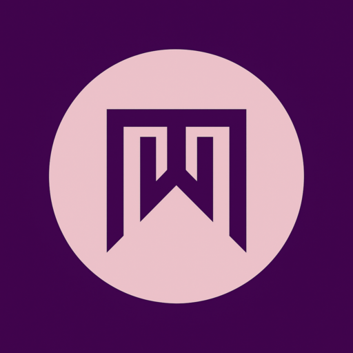
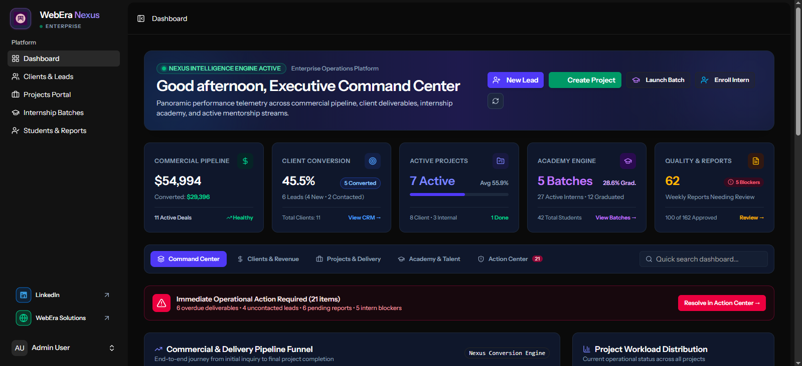
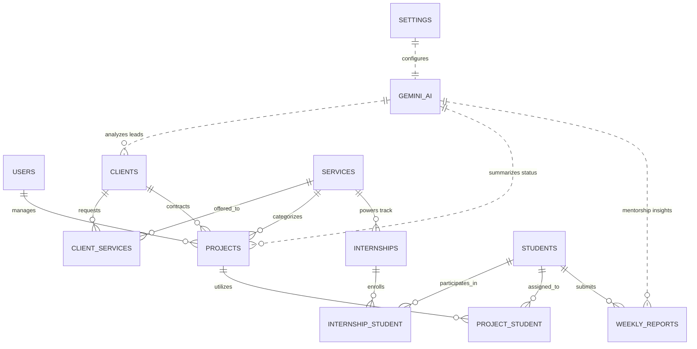

<p align="center">
  
</p>

<h1 align="center">WebEra Nexus™</h1>

<p align="center">
  <strong>Next-Generation Enterprise Operations, Client CRM, Project Delivery & Internship Academy Management System</strong><br>
  <em>Engineered with Laravel 13, Inertia.js v3, Vue 3, TypeScript, Tailwind CSS v4 & Google Gemini AI</em>
</p>

<p align="center">
  <a href="#-project-preview"></a>
  <a href="https://laravel.com"></a>
  <a href="https://vuejs.org"></a>
  <a href="https://inertiajs.com"></a>
  <a href="https://www.typescriptlang.org"></a>
  <a href="https://tailwindcss.com"></a>
  <a href="https://ai.google.dev"></a>
  <a href="LICENSE"></a>
</p>

---

## 🌟 Executive Project Preview

<p align="center">
  
</p>
<p align="center"><em>Figure 1.0: WebEra Nexus Central Executive Command Center — Real-time telemetry across revenue pipeline, client conversions, active client deliverables, deadline radar, and internship cohort performance.</em></p>

---

## 🎖️ Dedication to WebEra Solutions PK

> **"Excellence is not an act, but a habit. True growth lies in going beyond what is expected."**

This project is proudly and wholeheartedly dedicated to **[WebEra Solutions PK](https://weberasolutionspk.com/)**.

During my **6-week Frontend Development Internship** at WebEra Solutions PK:

- I dedicated myself to mastering modern web development workflows, meeting every high standard set by the mentorship team.
- Beyond successfully completing and presenting all assigned internship task projects, I took the independent initiative to architect, design, and build **WebEra Nexus**.
- **WebEra Nexus** was built from the ground up as a fully integrated, enterprise-scale management ecosystem — unifying client relationship management, internal project delivery, and cohort-based academy training with real-time **Google Gemini AI** intelligence.

This application stands as a dedicated token of gratitude, professional innovation, and technical excellence honoring the mentorship, culture, and vision of **WebEra Solutions PK**.

🔗 **Connect with WebEra Solutions PK:**  
🌐 **Website:** [weberasolutionspk.com](https://weberasolutionspk.com/)  
💼 **LinkedIn:** [WebEra Solutions on LinkedIn](https://www.linkedin.com/company/webera-solutions)

---

## ⚡ What is WebEra Nexus?

**WebEra Nexus** is an all-in-one Enterprise Resource & Academy Operations Platform tailored for modern software agencies and technology training academies. Built on the bleeding edge of the modern web stack, it solves a fundamental challenge: **bridging commercial client operations with technical talent training**.

### The Core Problem it Solves:

1. **Siloed Client Management**: Disconnected communication channels lead to slow lead qualification and lost pipeline value.
2. **Project Delivery Blindspots**: Teams often lack visibility into overlapping client deadlines, pending reviews, and resource allocations.
3. **Internship Academy Overhead**: Managing multiple training batches, tracking student progress, and reviewing weekly reports manually is time-consuming and prone to delays.

### The Nexus Solution:

WebEra Nexus merges **Executive CRM**, **Delivery Tracking**, **Internship Batch Cohorts**, and **Generative AI** into a single cohesive SPA with instant reactive visits, zero layout shift, and deep data telemetry.

---

## 🚀 Key Modules & System Features

### 1. 📊 Executive Command Center (Real-Time Dashboard)

- **Financial & Commercial Pipeline**: Instant calculation of total pipeline valuation, converted revenue figures, and count of active high-value deals.
- **Conversion Engine Analytics**: Track lead funnels (`new_lead` ➔ `contacted` ➔ `converted`), aggregate client totals, and real-time conversion rates.
- **Project Delivery Radar**: Monitors ongoing project stages (`planning`, `in_progress`, `under_review`, `completed`), visualizes average completion progress, and flags upcoming 14-day deadlines.
- **Critical Risk Overdue Alerting**: Automatically surfaces projects past their delivery date for immediate intervention.
- **Internship Academy Overview**: Batch progress bars, active student counts, average student completion velocity, and graduation rate statistics.

### 2. 💼 Intelligent CRM & Client Lead Pipeline

- **Lifecycle Management**: Track leads through customizable deal stages with multi-service inquiries and estimated budget tracking.
- **Direct Service Tagging**: Associate clients with specialized company services (WordPress Development, Full-Stack SaaS, Shopify Stores, SEO Audits, Enterprise AI Automations).
- **🤖 Gemini AI Lead Intelligence**:
    - One-click generation of strategic client briefs.
    - Automatically analyzes client history, interested tech stacks, and notes to deliver actionable executive talking points and closing strategies.

### 3. 🛠️ Projects Portal & Resource Orchestration

- **Dual-Track Delivery**: Seamlessly manage **Client Deliverables** (linked to client contracts) and **Internal Academy Projects**.
- **Cross-Functional Team & Intern Assignment**: Assign active student interns directly to live or sandbox projects to build production experience.
- **Timeline & Milestone Tracking**: Live progress sliders, deadline monitors, and review checkpoints.
- **🤖 Gemini AI Project Health Status**:
    - Generates concise executive status summaries evaluating project health, delivery risks, and milestone velocity.

### 4. 🎓 Internship Academy & Batch Cohort Management

- **Cohort Lifecycle Tracking**: Manage training tracks across batches with structured start and graduation dates.
- **Diverse Specialized Tracks**: Full-Stack Web Development, UI/UX & Product Design, Python & AI Engineering, Cross-Platform Mobile Apps.
- **Multi-Batch Student Enrollment**: Students can maintain multiple enrollment histories, switch active batches, and track progress per batch.
- **Graduation & Certification**: Mark batches completed, calculate cohort completion rates, and issue graduation grading.

### 5. 📝 Student Performance & Weekly Sprint Logs

- **Structured Sprint Submissions**: Students log weekly sprint reports capturing **Tasks Completed**, **Key Learnings**, and **Blockers Encountered**.
- **Progress & Grading Matrix**: Mentors review student performance, update milestone completion percentages, and track individual growth.
- **🤖 Gemini AI Mentorship Assistant**:
    - Automatically digests lengthy student weekly submissions into a 2-point executive mentor brief.
    - Highlights student breakthroughs and immediately flags roadblocks requiring senior mentor support.

### 6. ⚙️ Dynamic Service Catalog & AI Settings

- **Real-Time Service Management**: Enable, disable, or create new client services and internship tracks without schema migrations.
- **AI Model Orchestration**: Toggle global AI functionality, configure custom Gemini API keys, and select preferred models (`gemini-1.5-flash`, `gemini-1.5-pro`) directly from the administrative settings.

---

## 🏛️ System Architecture



---

## 💻 Elite Technology Stack

| Layer                  | Technology                    | Version        | Purpose / Highlights                                                               |
| :--------------------- | :---------------------------- | :------------- | :--------------------------------------------------------------------------------- |
| **Backend Framework**  | **Laravel**                   | `^13.17`       | Robust MVC foundation, Eloquent ORM, service container, RESTful routing            |
| **Authentication**     | **Laravel Fortify**           | `^1.37`        | Headless, hardened authentication engine with 2FA and password resets              |
| **SPA Bridge**         | **Inertia.js**                | `^3.0`         | Zero-API SPA protocol connecting Laravel backend directly with Vue 3               |
| **Route Typing**       | **Laravel Wayfinder**         | `^0.1.14`      | Generates type-safe TypeScript functions for named routes & controllers            |
| **Frontend Framework** | **Vue.js**                    | `^3.5.13`      | Composition API, `<script setup>`, reactive state, and high-performance components |
| **Styling Engine**     | **Tailwind CSS**              | `^4.1.1`       | Next-gen utility-first CSS with lightning-fast `@tailwindcss/vite` engine          |
| **UI Primitives**      | **Reka UI (Radix)**           | `^2.9.8`       | Unstyled, accessible component primitives (dialogs, dropdowns, toolbars)           |
| **Icons & Feedback**   | **Lucide Vue & Sonner**       | `^1.17 / ^2.0` | Ultra-clean iconography and smooth notifications/toast alerts                      |
| **AI Intelligence**    | **Google Gemini API**         | `1.5 Flash`    | Enterprise LLM integration for automated briefs, summaries & evaluations           |
| **Language & Typing**  | **PHP 8.3+ / TypeScript 5**   | Strict         | End-to-end type safety across backend classes and frontend views                   |
| **Testing & Quality**  | **Pest PHP / Pint / PHPStan** | Strict         | Automated testing, PSR-12 formatting, and static analysis                          |

---

## 📂 Project Structure

```text
WebEra-Nexus/
├── app/
│   ├── Http/
│   │   └── Controllers/         # Clean Single-Action & Resource Controllers
│   │       ├── AiController.php            # Google Gemini AI Endpoint handler
│   │       ├── ClientController.php        # CRM & Lead pipeline management
│   │       ├── DashboardController.php     # Real-time analytics & metric telemetry
│   │       ├── InternshipController.php    # Cohorts, tracks & batches
│   │       ├── ProjectController.php       # Project planning & execution
│   │       ├── ServiceController.php       # Dynamic service catalog
│   │       ├── StudentController.php       # Student enrollment & grading
│   │       └── WeeklyReportController.php   # Student weekly logs
│   ├── Models/                  # Eloquent models with rich relationships
│   └── Services/
│       └── Ai/                  # Modular AI Service Layer (GeminiAiService)
├── database/
│   ├── migrations/              # Optimized database schema migrations
│   └── seeders/                 # Comprehensive demo data seeders
├── public/
│   └── assets/                  # High-resolution logos & dashboard previews
├── resources/
│   ├── js/
│   │   ├── components/          # Reusable UI component library (Reka + Tailwind)
│   │   ├── layouts/             # AppSidebar, AppHeader, and Auth layouts
│   │   ├── pages/               # Inertia page components
│   │   │   ├── Clients/         # Index, Create, Edit, Show with AI Briefs
│   │   │   ├── Internships/     # Batch management and student lists
│   │   │   ├── Projects/        # Project Kanban/List & Student assigners
│   │   │   ├── Students/        # Student detail, Batch history & Weekly reports
│   │   │   ├── auth/            # Hardened Fortify login & password reset
│   │   │   └── Dashboard.vue    # Enterprise command center
│   │   └── routes/              # Wayfinder generated type-safe routes
└── routes/
    └── web.php                  # Application route registry with auth middleware
```

---

## ⚙️ Quickstart Installation Guide

Follow these steps to set up **WebEra Nexus** in your local environment.

### 📋 Prerequisites

- **PHP**: `^8.3` or higher (with `pdo`, `mbstring`, `curl`, `openssl` extensions)
- **Composer**: `^2.5`
- **Node.js**: `^20.x` or `^22.x` & **npm** or **pnpm**
- **Database**: SQLite (default) or MySQL `8.0+`

### 1. Clone the Repository

```bash
git clone https://github.com/imtiazaly/WebEra-Nexus.git
cd WebEra-Nexus
```

### 2. Install Dependencies

```bash
# Install PHP dependencies
composer install

# Install Frontend dependencies
npm install
```

### 3. Configure Environment

```bash
# Duplicate example environment file
cp .env.example .env

# Generate application encryption key
php artisan key:generate
```

Open `.env` and configure your settings:

```ini
APP_NAME="WebEra Nexus"
APP_ENV=local
APP_DEBUG=true
APP_URL=http://localhost:8000

# Database Configuration (SQLite default)
DB_CONNECTION=sqlite

# Optional: Google Gemini API (Can also be set in Dashboard Settings)
GEMINI_API_KEY=your_gemini_api_key_here
GEMINI_MODEL=gemini-1.5-flash
```

### 4. Run Migrations & Seeders

Populate the database with enterprise-ready dummy data (clients, projects, services, internship batches, students, and reports):

```bash
php artisan migrate:fresh --seed
```

### 5. Build Assets & Start Development Server

```bash
# Run both Vite and Laravel development server concurrently
npm run dev

# Or in separate terminals:
# Terminal 1:
php artisan serve

# Terminal 2:
npm run dev
```

Visit **`http://localhost:8000`** in your browser.

---

## 🔑 Default Seeded Credentials

To test the system immediately with full administrator privileges:

| Role                     | Email              | Password   |
| :----------------------- | :----------------- | :--------- |
| **System Administrator** | `admin@webera.com` | `password` |

---

## 🛡️ Security & Reliability

- **Hardened Authentication**: Implemented via Laravel Fortify with brute-force rate-limiting and verified session state.
- **CSRF & XSS Protection**: Automatic token validation on all Inertia state transitions with output sanitization.
- **Fail-Safe AI Layer**: The `GeminiAiService` features timeout safeguards, null-coalescing fallbacks, and database toggle protection to ensure the application remains 100% operational even without an internet connection or API quota.

---

## 🤝 Acknowledgments & Special Thanks

- **WebEra Solutions PK**: For the exceptional mentorship, practical industry exposure, and encouraging environment during the 6-week internship program.
- **Laravel Community**: For crafting the most productive web framework in the software engineering landscape.
- **Vue & Inertia Teams**: For redefining modern single-page applications with unmatched developer experience.

---

<p align="center">
  <strong>Crafted with passion, dedication, and precision for WebEra Solutions PK.</strong><br>
  © 2026 WebEra Nexus. All Rights Reserved.
</p>
